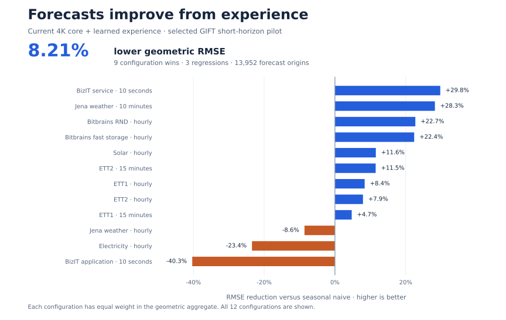
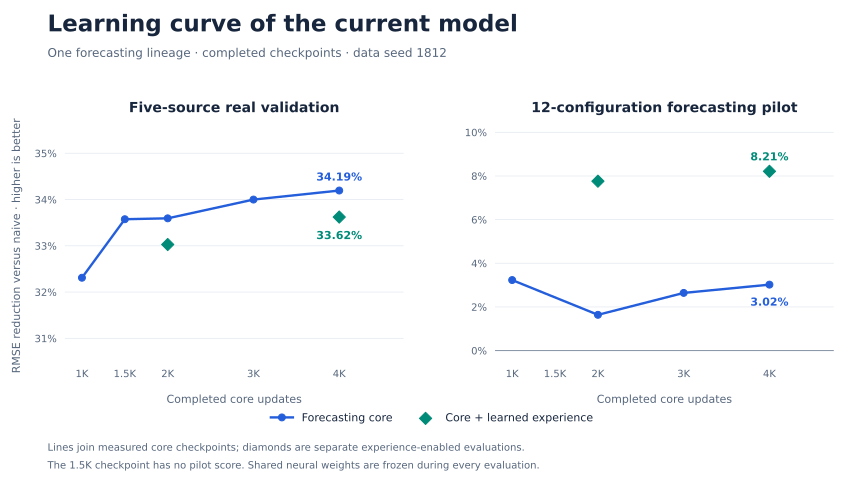

# TinyMind

### Forecasts that improve from experience

**TinyMind is a forecasting model that learns from arriving outcomes while its shared neural weights stay frozen.** A recurrent core predicts the future; learned experience memory uses earlier forecast errors to improve subsequent predictions within each stream.

The current experience-enabled model delivers **8.21% lower geometric RMSE than seasonal naive** on the selected GIFT short-horizon pilot. Against the **same forecasting core without experience memory**, it lowers RMSE by **5.35%**, improving **11 of 12 configurations**. Evaluation performs **zero shared-weight optimizer updates**.

Evidence through **9 November 2026**. [Full forecasting study](docs/current-research-2026-11-09.md) · [Results](benchmarks/current-forecasting-comparisons.csv) · [Verification](reproducibility/README.md)

## How the model learns from experience

1. **Forecast:** the recurrent core carries information from observed history into the future sequence.
2. **Observe:** outcomes become feedback only after they arrive.
3. **Remember:** learned representations and evidence weighting update stream-local residual memory.
4. **Improve:** confidence-controlled corrections refine later forecasts, with shared neural weights still frozen.

Experience persists across successive forecasts in the same stream. This separates learning during pretraining from adaptation as new observations arrive. The research contribution is the combination of a forecasting core and learned experience memory, evaluated through its effect on future predictions.

## Measured forecasting results

| Comparison | Geometric RMSE reduction | Configuration wins / losses |
|---|---:|---:|
| Experience-enabled model vs the same frozen core | **5.35%** | **11 / 1** |
| Experience-enabled model vs seasonal naive | **8.21%** | **9 / 3** |
| Forecasting core vs naive on five-source validation | **34.19%** | **5 / 0** |

The pilot includes **12 short-horizon configurations and 13,952 forecast origins per measured method**. The separate real validation pool includes **five source configurations and 1,720 forecast windows**. Each suite gives equal weight to configuration RMSE ratios; positive reduction means lower error.

The graph shows the current experience-enabled model on every pilot configuration. Its geometric aggregate improves even though three configurations regress.

## Learning curve of the current model

These curves follow one forecasting lineage through **1K, 1.5K, 2K, 3K and 4K completed core updates**. Experience-enabled evaluations are separate points at 2K and 4K. Every point is measured; the 1.5K checkpoint has no pilot score.

## What the results establish

The experience path improves future-forecast accuracy on this pilot while shared weights remain frozen. On the separate five-source pool, its correction raises RMSE by **0.87%** versus the 4K core, so the frozen core remains the validation-selected state. The full study retains both outcomes and the synthetic retention results.

These are selected short-horizon measurements. Two data seeds share one initialization, with no confidence intervals or independent external replication. Published Moirai-2 and TimesFM-3 remain stronger on the twelve reference keys; those models were not rerun under matched training and hardware. Broader horizons and repeatable transfer remain research questions.

[Every pilot configuration](benchmarks/current-forecasting-pilot.csv) · [Every validation configuration](benchmarks/current-forecasting-real-validation.csv) · [Synthetic controls](benchmarks/current-synthetic-summary.csv) · [Figure sources](figures/README.md)

[Earlier research archive](docs/research-archive.md)
