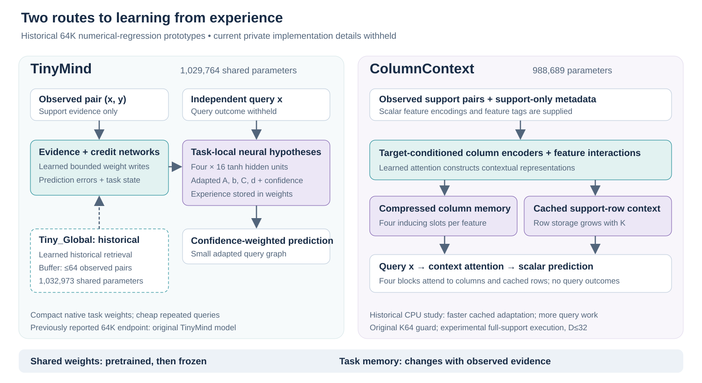
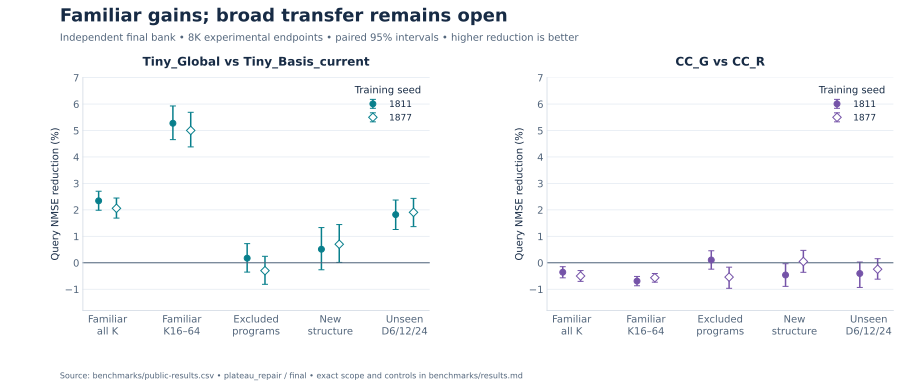
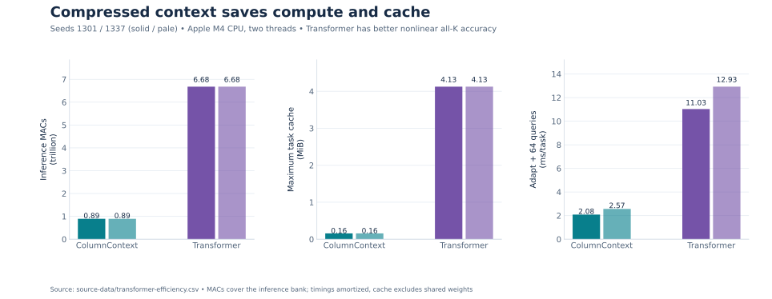
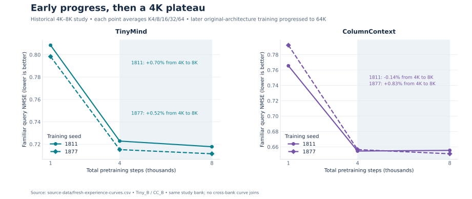
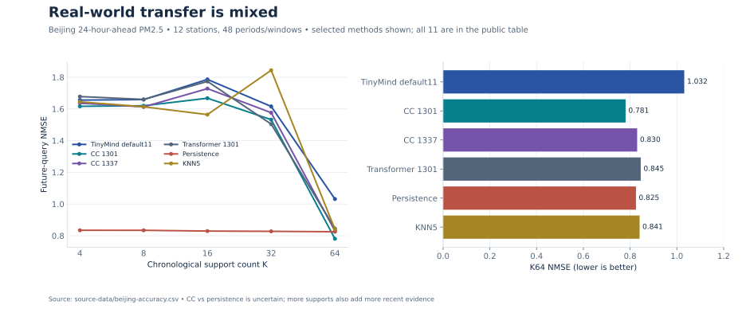

# TinyMind

### Learning and adapting from experience, at approximately one million parameters

TinyMind is a research project studying how a compact neural system can use observed examples to change its predictions. We investigate two routes: **learned updates to task-specific neural weights** and **compressed, example-conditioned attention**.

**Current validated experiments predominantly concern numerical function learning and scalar regression.** The wider aim is learning from experience; language, agent learning, arbitrary relationship discovery and general intelligence are outside the demonstrated scope.

This public repository shares audited aggregate results, methodology and figures. Model implementations, weights and private research assets remain private. Evidence cutoff: **1 November 2026**.

[Architecture](docs/architecture.md) · [Research progress](docs/research-progress.md) · [Benchmarks](benchmarks/results.md) · [Methodology](docs/methodology.md) · [Limitations](docs/limitations.md) · [Reproducibility](reproducibility/README.md)

## The research question

Can a small, pretrained neural system learn useful relationships from a short sequence of input/outcome pairs while its shared weights stay frozen? Can that adaptation use earlier evidence, improve independent predictions and eventually transfer to genuinely unfamiliar relationships?

We separate **within-task adaptation** as observations arrive from **pretraining progress** across many tasks. More examples can improve an individual task even when longer pretraining has stopped improving held-out error.

## Two architectures, two forms of task memory

| | TinyMind | TinyMind-CC / ColumnContext |
| --- | --- | --- |
| Shared parameters | **1,029,764** in the original D32-compatible model | **988,689** |
| Task memory | Four small neural hypotheses; learned updates to hidden/output weights and confidence | Target-conditioned column slots and cached support-row representations |
| Adaptation | Shared evidence/credit networks write task-local neural weights | Shared encoders and attention construct task-local context |
| Query behavior | Evaluate the small adapted hypotheses | Attend to compressed columns and cached rows |
| Research role | Study evidence-dependent neural weight adaptation | Study efficient contextual learning and the accuracy cost of compression |

Both exist because they test different ways of storing experience and spending computation. ColumnContext has faster cached adaptation in the measured settings; TinyMind has a much cheaper repeated query readout. ColumnContext's row cache still grows with the support count.

**Tiny_Global** is an experimental TinyMind variant with **1,032,973 parameters**. It adds learned historical retrieval and scalar ensemble-error feedback. It has demonstrated familiar-task benefits; it has **not** been promoted to the validated default. CC_D, CC_G and CC_DG are experimental training interventions on the unchanged ColumnContext architecture. See [checkpoint status](docs/architecture.md#checkpoint-status).

## What the evidence supports

| Evidence category | Finding | Scope |
| --- | --- | --- |
| **Validated finding** | Both prototypes learn useful predictions from observed examples with shared weights frozen | Predominantly controlled numerical regression; independent query evaluation |
| **Experimental finding** | Tiny_Global reduces familiar all-K error by **2.34% / 2.06%** versus the strongest declared matched controls | Seeds 1811 / 1877, final bank, 8K checkpoints, K4/8/16/32/64 |
| **Experimental finding** | Its familiar K16/32/64 reduction is **5.27% / 5.00%** | Same benchmark and controls; a secondary support-size endpoint |
| **Frozen causal diagnostic** | Corrupting historical pairings, disabling new retrieval or freezing hidden updates worsens familiar predictions | Same experimental weights, development bank; intervention effects do not prove arbitrary rule invention |
| **Validated comparison** | ColumnContext uses **7.48× less inference MAC work** and **26.24× less maximum task-cache storage** than the tested Transformer | Matched data/step recipe; measured CPU study; Transformer has better all-K nonlinear accuracy |
| **Unsuccessful hypothesis** | Fresh experience, several learning-mechanism changes and the latest repairs did not overcome the broad 4K plateau | Bounded studies; no 10K/12K extension or checkpoint promotion |

### Familiar gains, unresolved unfamiliar transfer

Tiny_Global versus **Tiny_Basis_current**, final query NMSE; lower is better. Intervals are paired 95% whole-function bootstrap intervals.

| Seed | Benchmark | Control NMSE | Tiny_Global NMSE | Error reduction [95% CI] |
| --- | --- | ---: | ---: | --- |
| 1811 | Familiar, all K | 0.682809 | 0.666817 | **2.34% [1.99, 2.70]** |
| 1877 | Familiar, all K | 0.676726 | 0.662791 | **2.06% [1.69, 2.45]** |
| 1811 | Familiar, K16/32/64 | 0.480355 | 0.455022 | **5.27% [4.65, 5.93]** |
| 1877 | Familiar, K16/32/64 | 0.473873 | 0.450167 | **5.00% [4.38, 5.69]** |
| 1811 | Excluded programs, all K | 0.895739 | 0.894178 | 0.17% [−0.35, 0.72] |
| 1877 | Excluded programs, all K | 0.893749 | 0.896406 | −0.30% [−0.81, 0.25] |

The excluded-program intervals cross zero in both seeds. **Generalization to arbitrary unfamiliar relationships remains unsolved.** Complete, full-precision results and alternate matched controls are in [public-results.csv](benchmarks/public-results.csv); the exact study conditions are in [results.md](benchmarks/results.md).

### Efficiency comes with an accuracy tradeoff

The conventional **994,945-parameter axial Transformer** reduces nonlinear all-K error by **2.33% / 5.33% relative to ColumnContext** in seeds 1301 / 1337. ColumnContext retains large measured compute and cache advantages. This comparison matches training data, steps and optimizer settings; compute, architectural components and initialization differ. It establishes a tradeoff under this recipe, not a uniform architecture winner.

### Pretraining progress and its limits

Early pretraining improves held-out familiar prediction. Extending the original fresh-experience arms from 4K to 8K yields only **0.70% / 0.52%** familiar reductions for TinyMind and **−0.14% / 0.83%** for CC on that study's bank. The latest independent repair study also fails its full gates. [Progress and failed experiments](docs/research-progress.md) includes the complete chronology and [repair curves](figures/plateau-repair.svg).

### Real-world results are mixed

On a chronological, 24-hour-ahead PM2.5 test across twelve Beijing stations, CC's K64 NMSE is **0.780720 / 0.830184**, versus **0.825067** for persistence. Its advantage over persistence is statistically uncertain. TinyMind's validated default scores **1.031620** and loses to KNN5 (**0.840694**). Persistence is stronger at smaller support sizes and much cheaper. Four additional, previously studied regression datasets provide conditional evidence with documented development/final row overlap. [Full real-world results and caveats](benchmarks/results.md#real-world-evaluation).

## What remains unsolved

- Reliable acquisition of genuinely unfamiliar relationships and reusable cross-task concepts.
- Sustained pretraining progress beyond the observed plateau.
- Consistent accuracy across dimensions, support sizes, families and real datasets.
- Retention without prediction drift, reliable uncertainty and deployment robustness.
- Independent replication and broader application validation.

Our evidence does not identify a unique capacity, optimization or credit-assignment cause. Lower support fitting error alone is insufficient: some diagnostic interventions improve interpolation while worsening independent predictions. See [limitations](docs/limitations.md).

## Research roadmap

| Phase | Status | Milestone |
| --- | --- | --- |
| **1. Architecture research** | Prototypes completed | Working TinyMind and ColumnContext numerical-regression systems |
| **2. Learning mechanisms** | Partial evidence; ongoing | Evidence-dependent adaptation and useful historical retrieval; credit assignment and retention blockers remain |
| **3. Generalization** | Open | Consistent improvement on genuinely unfamiliar relationships, beyond supplied primitives |
| **4. Sustained pretraining** | Blocked by observed plateau | Demonstrate continued held-out progress before scaling training |
| **5. Independent validation** | Planned | Wider benchmarks, external replication, reliability and deployment evaluation |

## Inspect the evidence

Every numerical chart is generated from public aggregate tables. [Provenance](benchmarks/provenance.json) records private source identifiers and SHA256 hashes; [figure sources](figures/README.md) map each chart to its public inputs. Public scripts verify the exported arithmetic and regenerate numerical figures. Full training or inference reproduction requires assets withheld from this showcase.

No model weights, private model source, raw datasets, development logs or software reuse license are distributed here. Licensing for any future implementation or model release requires a separate decision.
