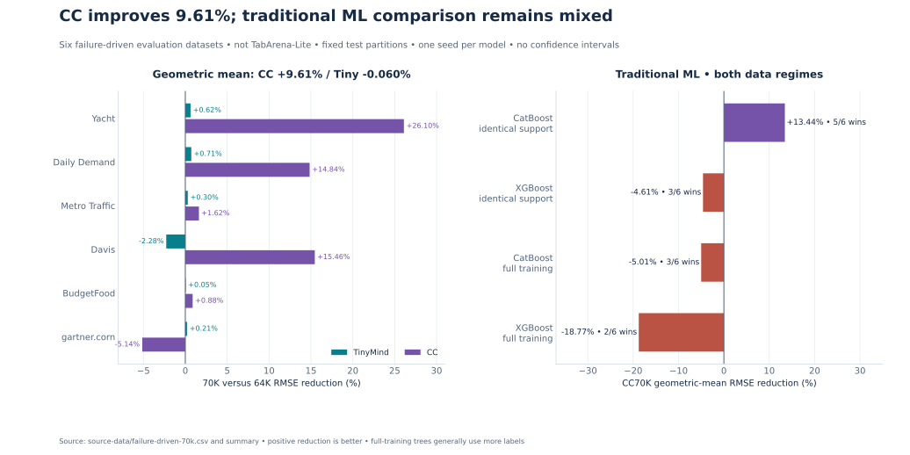
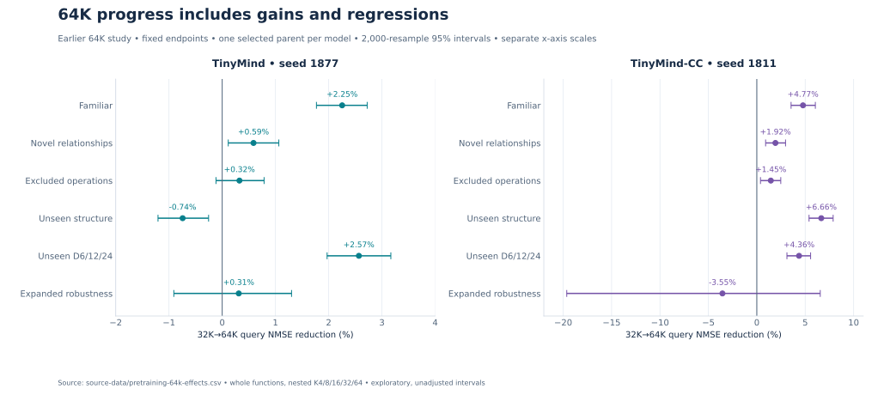
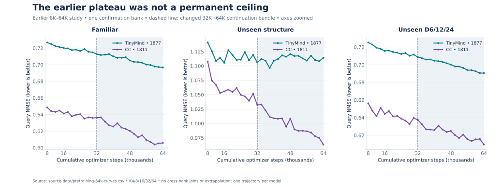
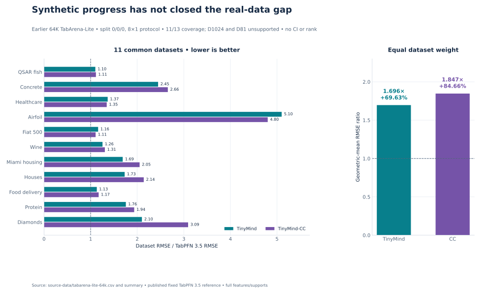

# Benchmark results and study cards

## Latest completed evidence — 9 November

The [current study cards](../docs/current-research-2026-11-09.md) cover the current forecasting model, its experience-memory improvement, two data-seed comparisons, completed learning curve, real validation and synthetic retention results. Earlier tabular research is stopped and its latest results are in the [archive](../docs/research-archive.md).

[Forecasting pilot rows](current-forecasting-pilot.csv) · [Real validation rows](current-forecasting-real-validation.csv) · [Forecasting comparisons](current-forecasting-comparisons.csv) · [Synthetic panels](current-synthetic-summary.csv) · [CC datasets and baselines](current-tabarena-results.csv) · [CC milestones](current-tabarena-summary.csv) · [Current provenance](current-research-provenance.json)

The new tables have 485 aggregate rows. The historical tables and their original result identifiers below retain their prior scopes.

## Original 5 November forecasting pilot

The active direction is forecasting with persistent experience adaptation. The completed selected GIFT pilot has **7.33% lower geometric RMSE versus our paired frozen forecaster**, with 12/12 configuration wins. Its extra gain over fixed RLS using the same learned features is only 0.20%, with six wins and six losses.

[The complete forecasting study card](../docs/forecasting-research-update.md) includes every selected configuration, all five controls, pinned public player references, independent-query and retention outcomes, causal label rules and limitations. [Full-precision aggregates](forecasting-pilot.csv), [geometric comparisons](forecasting-comparisons.csv) and [separate forecasting provenance](forecasting-provenance.json) support public arithmetic checks.

This is one seed, 12 short-horizon configurations and 13,952 original origins per method; it is not full GIFT, fev or TabArena-Lite. Several public models remain much stronger, and the learned gate's benefit beyond fixed rules is small. The historical tabular study cards below retain their original evidence dates and source identifiers.

Historical tabular evidence cutoff: **2 November 2026**. Every scored comparison below has a result ID in [public-results.csv](public-results.csv), with full-precision values and an exact source locator. [Provenance](provenance.json) records source hashes and export rules. Tables round displayed errors to six decimals and reductions to two decimals. Positive reduction favors the named candidate; negative is a regression. No cross-study error comparison is treated as matched.

## Latest 70K failure-driven regression: six datasets

**Scope:** six failure-driven evaluation datasets, **not TabArena-Lite**. Both trajectories completed 70K; one seed per architecture. Validation on the complete six-dataset cohort selected TinyMind **64K** and CC **70K** before separate test partitions were scored. These datasets informed development; held-out test rows do not make this untouched dataset-level validation.

**Headline:** CC70K has **9.61% lower geometric-mean test RMSE than CC64K**, improving on 5/6 datasets. Tiny70K has **0.060% higher** geometric-mean RMSE than Tiny64K, despite five small dataset gains. CC70K has **16.60% lower** error than the validation-selected Tiny64K, with 5/6 wins. Comparing the two fixed 70K endpoints gives a separate **16.65%** reduction for CC.

**Metric/support:** per-dataset test RMSE in the target's units, evaluated at the largest available nested support budget, up to 64. Aggregate ratios are `exp(mean(log(candidate RMSE / reference RMSE)))`, weighting each of the six datasets equally. Reduction is `100 × (1 − ratio)`; positive favors the candidate. Raw RMSEs across incompatible target units are not averaged. No intervals or official ranks are inferred.

### All six endpoint results

| Dataset | Original inputs | Neural support rows | Tiny64K RMSE | Tiny70K RMSE | CC64K RMSE | CC70K RMSE |
| --- | ---: | ---: | ---: | ---: | ---: | ---: |
| Yacht Hydrodynamics | 6 | 64 | 8.603968 | 8.550249 | 4.765602 | 3.521926 |
| Daily Demand Forecasting Orders | 12 | 36 | 30.495589 | 30.278793 | 30.568489 | 26.031082 |
| Metro Interstate Traffic Volume | 8 | 64 | 1956.810112 | 1951.010601 | 2006.322161 | 1973.727577 |
| carData::Davis | 4 | 64 | 4.985578 | 5.099016 | 5.809854 | 4.911670 |
| Ecdat::BudgetFood | 5 | 64 | 0.134389 | 0.134322 | 0.134889 | 0.133706 |
| agridat::gartner.corn | 7 | 64 | 6.161885 | 6.149228 | 5.709660 | 6.003137 |

CC's regression is gartner.corn (**5.709660→6.003137** RMSE). TinyMind's is Davis (**4.985578→5.099016**). Both negative outcomes are preserved alongside improvements.

### Traditional ML: two labeled-data regimes

CatBoost and XGBoost were evaluated with fixed 500-tree configurations and no test tuning. Matched-support baselines use exactly the neural support rows. Full-training baselines use all available training rows, supplying more labels on five datasets and the same 36 rows on Daily Demand. Neural models are pretrained; matching task support does not match total training compute or data exposure.

The following tree scores share the same test rows as the endpoint table:

| Dataset | CatBoost matched RMSE | XGBoost matched RMSE | Full-training rows | CatBoost full RMSE | XGBoost full RMSE |
| --- | ---: | ---: | ---: | ---: | ---: |
| Yacht Hydrodynamics | 4.568101 | 1.459597 | 184 | 1.987632 | 0.947199 |
| Daily Demand Forecasting Orders | 38.034466 | 38.233604 | 36 | 38.034466 | 38.233604 |
| Metro Interstate Traffic Volume | 2215.588727 | 2278.629708 | 28254 | 2209.138751 | 2291.871697 |
| carData::Davis | 5.146554 | 4.590135 | 120 | 4.194212 | 3.994937 |
| Ecdat::BudgetFood | 0.145240 | 0.155511 | 14383 | 0.126181 | 0.128371 |
| agridat::gartner.corn | 5.892286 | 5.997688 | 2969 | 6.019752 | 5.971690 |

| Comparison | Candidate wins | Geometric-mean RMSE ratio | RMSE reduction |
| --- | ---: | ---: | ---: |
| Tiny70K / Tiny64K | 5/6 | 1.000597 | -0.06% |
| CC70K / CC64K | 5/6 | 0.903917 | +9.61% |
| CC70K / Tiny64K | 5/6 | 0.834014 | +16.60% |
| CC70K / Tiny70K | 5/6 | 0.833517 | +16.65% |
| CC70K / CatBoost, matched support | 5/6 | 0.865642 | +13.44% |
| CC70K / XGBoost, matched support | 3/6 | 1.046083 | -4.61% |
| CC70K / CatBoost, full training | 3/6 | 1.050090 | -5.01% |
| CC70K / XGBoost, full training | 2/6 | 1.187666 | -18.77% |

Positive reduction favors the candidate; negative is a regression. CC beats matched-support CatBoost overall, but remains behind matched-support XGBoost and both full-training baselines. A limited-support win does not establish general or commercial ML superiority.

**TabPFN 3.5 was unavailable locally and was not evaluated in this campaign.** Its earlier TabArena-Lite scores cannot be substituted into these six-dataset comparisons. Neither this cohort nor its conditional model ordering establishes an official TabArena rank.

### Limitations and verification

Only six datasets and one training seed per architecture are represented, with **4–12 original inputs** and one locked test partition per dataset. There is no matched control isolating diagnostic curriculum adaptation, no multi-seed continuation replication and no reported confidence interval. Test results condition on datasets already used for development; broader untouched transfer, wider real-data accuracy and deployment reliability are unvalidated.

Both completed 6,000 additional optimizer steps to 70K, with **2,688,000 cumulative synthetic task presentations per model**. These are presentations, not unique mathematical functions. The earlier 100K objective was shortened in that campaign.

Retained audits verified 12,000 completed update records, validation selection before test prediction files, identical matched support IDs/test targets, preserved original columns and frozen shared weights during scoring. Independent audits rescored 216 real prediction files and 24 baseline files. These are retained audit observations, not independent external replication.

Inputs: [six-dataset aggregate results](source-data/failure-driven-70k.csv), [eight ratio summaries](source-data/failure-driven-70k-summary.csv). Comparisons R0534–R0589 in [public-results.csv](public-results.csv) retain exact values without invented intervals. Sources S62–S69 use evidence labels and hashes in [provenance](provenance.json).

Dataset references: [Yacht](https://archive.ics.uci.edu/dataset/243/yacht+hydrodynamics), [Daily Demand](https://archive.ics.uci.edu/dataset/409/daily+demand+forecasting+orders), [Metro Traffic](https://archive.ics.uci.edu/dataset/492/metro+interstate+traffic+volume), [Davis](https://vincentarelbundock.github.io/Rdatasets/doc/carData/Davis.html), [BudgetFood](https://vincentarelbundock.github.io/Rdatasets/doc/Ecdat/BudgetFood.html), [gartner.corn](https://vincentarelbundock.github.io/Rdatasets/doc/agridat/gartner.corn.html). No dataset files are redistributed.

## Earlier 32K→64K pretraining

**Status:** completed, audited experimental endpoints; no default promotion. Original TinyMind / CC parameter counts are **1,029,764 / 988,689**. Both completed **64,000 cumulative optimizer steps** and **2,304,000 synthetic task presentations per model**: 256,000 through 32K plus 2,048,000 during continuation. These are presentations, not unique mathematical functions.

**Training/selection:** TinyMind seed **1877**, CC seed **1811**; one synthetic-validation-selected 32K parent each, saved AdamW moments, 32K additional physical-batch-64 steps. Prior proportions and conditioning changed together. Synthetic/real confirmation did not select the parents. The table uses **fixed 64K** checkpoints; separately validation-selected Tiny 62K / CC 64K are not substituted. [Complete continuation methodology](../docs/methodology.md#earlier-32k64k-continuation).

**Evaluation:** a newly locked confirmation bank, 736 functions total; 128 per track except unseen dimensions (96). Main D4/8/16/32, withheld D6/12/24, nested K4/8/16/32/64, independent query rows. Query NMSE is averaged under the declared track weighting; lower is better. The chart's 8K→64K checkpoints are all re-evaluated on this same bank, rather than joined across studies.

**Intervals:** 2,000 paired whole-function resamples stratified by D/family, nested K preserved, bootstrap seed 913867. Exploratory, unadjusted, conditional on one selected pretrained trajectory per architecture.

| ID | Architecture / seed | Track | 32K NMSE | 64K NMSE | Reduction [95% CI] |
| --- | --- | --- | ---: | ---: | --- |
| R0432 | TinyMind / 1877 | Familiar | 0.712757 | 0.696700 | +2.25% [+1.77, +2.72] |
| R0433 | TinyMind / 1877 | Novel relationships | 0.821405 | 0.816576 | +0.59% [+0.11, +1.06] |
| R0434 | TinyMind / 1877 | Excluded operations | 0.881608 | 0.878752 | +0.32% [-0.12, +0.79] |
| R0435 | TinyMind / 1877 | Unseen structure | 1.105967 | 1.114185 | -0.74% [-1.21, -0.26] |
| R0436 | TinyMind / 1877 | Unseen D6/12/24 | 0.708710 | 0.690518 | +2.57% [+1.97, +3.17] |
| R0437 | TinyMind / 1877 | Expanded robustness | 0.772900 | 0.770497 | +0.31% [-0.91, +1.30] |
| R0438 | TinyMind-CC / 1811 | Familiar | 0.636150 | 0.605796 | +4.77% [+3.54, +6.05] |
| R0439 | TinyMind-CC / 1811 | Novel relationships | 0.760040 | 0.745423 | +1.92% [+0.91, +2.97] |
| R0440 | TinyMind-CC / 1811 | Excluded operations | 0.825335 | 0.813386 | +1.45% [+0.38, +2.48] |
| R0441 | TinyMind-CC / 1811 | Unseen structure | 1.032302 | 0.963561 | +6.66% [+5.40, +7.89] |
| R0442 | TinyMind-CC / 1811 | Unseen D6/12/24 | 0.637394 | 0.609576 | +4.36% [+3.11, +5.56] |
| R0443 | TinyMind-CC / 1811 | Expanded robustness | 0.730498 | 0.756432 | -3.55% [-19.63, +6.55] |

Both improve familiar NMSE; CC improves unseen structure **6.66%**, while Tiny regresses **0.74%**. Tiny excluded-operation and both expanded-robustness intervals cross zero; CC's nominal expanded-robustness regression is retained. Familiar/other synthetic gains do not establish consistent real-world accuracy or arbitrary unfamiliar relationship learning.

**Historical interpretation:** the separate 8K→32K experiment and this continuation demonstrate that the earlier 4K–8K plateau was not a permanent ceiling. The original failed gates and their unrun gated endpoints remain recorded below. Neither later gains nor current regressions overwrite those historical outcomes.

Public inputs: [endpoint effects](source-data/pretraining-64k-effects.csv), [confirmation curves](source-data/pretraining-64k-curves.csv), [step/exposure audit](source-data/pretraining-64k-exposure.csv). Sources S37–S47 in [provenance](provenance.json) bind the results to the continuation and broader-pretraining reports and audits.

### Earlier 64K small-support real confirmation

Fixed 32K versus 64K, K4/8/16/32/64, eight support draws on a fixed query set per dataset. Diabetes progression is D10 with disjoint train/validation/test roles; D12 Facebook, D5 Liver and D22 SML2010 are reused guardrails. No real labels trained shared neural weights or selected checkpoints. These are descriptive aggregate NMSE changes, without confidence intervals or independent dataset replication.

| ID | Architecture | Dataset | 32K NMSE | 64K NMSE | Reduction |
| --- | --- | --- | ---: | ---: | ---: |
| R0444 | TinyMind | Diabetes progression | 0.773532 | 0.768687 | +0.63% |
| R0445 | TinyMind | Facebook pre/post | 1.170969 | 1.111410 | +5.09% |
| R0446 | TinyMind | Liver SGPT | 0.759436 | 0.763974 | -0.60% |
| R0447 | TinyMind | SML2010 dining | 0.852693 | 0.860438 | -0.91% |
| R0448 | TinyMind-CC | Diabetes progression | 0.757808 | 0.784917 | -3.58% |
| R0449 | TinyMind-CC | Facebook pre/post | 1.161949 | 1.231715 | -6.00% |
| R0450 | TinyMind-CC | Liver SGPT | 0.724023 | 0.805518 | -11.26% |
| R0451 | TinyMind-CC | SML2010 dining | 1.012805 | 0.778921 | +23.09% |

Tiny gains on Diabetes/Facebook but regresses on Liver/SML2010; CC improves SML2010 but regresses on the other three all-K aggregates. Support-specific gains do not imply all-K gains. [Full point aggregates](source-data/pretraining-64k-real.csv) retain exact values and both checkpoint source identifiers. Real-world accuracy remains inconsistent despite synthetic improvements.

## Earlier TabArena-Lite regression at 64K

**Status:** fixed original-architecture 64K checkpoints, frozen shared weights; local audited comparison, not an official leaderboard submission or rank. Tiny seed 1877, CC seed 1811. Both are experimental.

**Protocol:** 13 official Lite regression tasks; repeat 0/fold 0/sample 0; 8 inner folds × 1 set and full refit; one fixed neural configuration, no HPO. All original features and official training/test rows are retained. All nine preprocessed support fingerprints, targets and outer/inner splits match between Tiny and CC. Exact native-equation execution extends support handling beyond the original K64 admission guard, with no feature expansion or support subsampling. D>32 is unsupported. [Detailed preprocessing, executor and baseline protocol](../docs/methodology.md#earlier-tabarena-lite-regression-protocol).

**Baselines:** published TabPFN 3.5, CatBoost and XGBoost fixed-configuration scores on aligned official splits/8×1 scoring. They were not rerun locally and do not have matched pretraining or compute. Source hashes/configuration suites are in [provenance](provenance.json).

All 13 datasets are retained below. RMSE is in each dataset's own target units. Unsupported is a coverage limit, not a missing score to impute. All dataset-level neural comparisons are R0452–R0528 in [public-results.csv](public-results.csv).

| Dataset | Original D | TinyMind RMSE | CC RMSE | TabPFN 3.5 RMSE | CatBoost RMSE | XGBoost RMSE |
| --- | ---: | ---: | ---: | ---: | ---: | ---: |
| QSAR_fish_toxicity | 6 | 0.969251 | 0.980343 | 0.880123 | 0.917583 | 0.945157 |
| concrete_compressive_strength | 8 | 9.311635 | 10.105118 | 3.803394 | 4.542111 | 5.037817 |
| healthcare_insurance_expenses | 6 | 5473.665920 | 5390.921025 | 4006.123686 | 4110.344471 | 4264.447087 |
| airfoil_self_noise | 5 | 4.672184 | 4.398383 | 0.916208 | 1.474840 | 1.427014 |
| Another-Dataset-on-used-Fiat-500 | 7 | 776.639524 | 740.471208 | 668.790126 | 699.310636 | 728.536301 |
| QSAR-TID-11 | 1024 | Unsupported | Unsupported | 0.801724 | 0.847913 | 0.857810 |
| wine_quality | 12 | 0.724940 | 0.753842 | 0.577354 | 0.611791 | 0.613844 |
| miami_housing | 15 | 127972.802039 | 155468.406258 | 75782.721635 | 81043.445387 | 89666.315826 |
| houses | 8 | 0.312552 | 0.386535 | 0.180612 | 0.213315 | 0.217459 |
| superconductivity | 81 | Unsupported | Unsupported | 8.824440 | 9.263817 | 9.416369 |
| Food_Delivery_Time | 9 | 8.217965 | 8.506157 | 7.253304 | 7.418670 | 7.442621 |
| physiochemical_protein | 9 | 5.009793 | 5.519985 | 2.852365 | 3.556597 | 3.544370 |
| diamonds | 9 | 1035.950923 | 1524.832309 | 493.122532 | 529.751017 | 538.641600 |

Both evaluate **11/13** datasets. QSAR-TID-11 (D1024) and superconductivity (D81) exceed the unchanged 32-feature limit. **TinyMind beats CC on 8/11; CC beats TinyMind on 3/11; no ties. Neither beats TabPFN 3.5, CatBoost or XGBoost on any of the 11 common datasets.** CC's three pairwise wins are healthcare insurance, airfoil and used Fiat 500.

Across common datasets, the relative RMSE ratio is `exp(mean(log(candidate RMSE / reference RMSE)))`; gap is `100 × (ratio − 1)`. Each dataset receives equal weight; positive gap is worse. This avoids averaging raw errors across incompatible units.

| ID | Candidate / reference | Common datasets | Candidate wins | Geometric-mean RMSE ratio | Relative RMSE gap |
| --- | --- | ---: | ---: | ---: | ---: |
| R0529 | TinyMind-CC / TinyMind | 11 | 3 | 1.088621 | +8.86% |
| R0530 | TinyMind-CC / TabPFN-3.5 | 11 | 0 | 1.846643 | +84.66% |
| R0531 | TinyMind-CC / CatBoost | 11 | 0 | 1.630121 | +63.01% |
| R0532 | TinyMind-CC / XGBoost | 11 | 0 | 1.583657 | +58.37% |
| R0533 | TinyMind / TabPFN-3.5 | 11 | 0 | 1.696314 | +69.63% |

The TabPFN 3.5 gap is **+69.63% TinyMind / +84.66% CC**. These point estimates have no reported confidence intervals or training-seed replication, and only one official outer split is evaluated. No official or estimated TabArena rank or commercial superiority is established. The earlier 64K Tiny/CC hardware settings differ, and published baseline timing comes from other compute; no matched speed claim is made.

Public inputs: [all 13 task aggregates](source-data/tabarena-lite-64k.csv), [relative RMSE summaries](source-data/tabarena-lite-64k-summary.csv). The verification recomputed 64,120 saved test predictions per neural model and checked paired supports/splits, full feature/row coverage, preserved weights and zero neural optimization. Sources S48–S55 bind these observations to retained reports and audit artifacts.

## Earlier proposed 64K→100K direction

Before the six-dataset experiment, 64K→100K failure-driven training with separate development data and 2K-step evaluations was proposed. That campaign's endpoint became 70K; its evidence is reported above. The later CC continuation through 150K is separate. Previously inspected scores cannot serve as untouched confirmation after influencing development.

## Historical studies — evidence through 1 November 2026

The following tables retain the original result IDs, checkpoints, banks, failed hypotheses and uncertainty. They do not describe the later 64K or latest 70K benchmarks.

## Historical original-lineage plateau repair

**Status:** experimental candidates, no promotion; complete development gates failed.

**Training:** two seeds 1811/1877, fresh original 4K parents restored with AdamW, 4K additional steps to 8K. Batch eight, ordinary normalized scalar query MSE, native LR 3e−5 and new Tiny components/current readers 3e−4. CC_D is a scaffolded task-law bundle; CC_G is clipping 1→5; CC_DG combines them.

**Evaluation:** development-selected Tiny_Global and CC_G; independently generated final functions with choices/checkpoints locked first. Main D4/8/16/32 × K4/8/16/32/64; familiar final 512 functions, excluded 128, structural 64, unseen-D6/12/24 192. Generally 64 disjoint queries per synthetic function; controlled cases can have 128. Learner normalization uses supports only.

**Metric:** per-function mean physical query squared error / that function's query-target variance, then average under locked family counts. **Intervals:** 5,000 paired whole-function bootstrap replicates, family/D stratified, preserving K curves; seeds separate, exploratory subgroups unadjusted. The primary endpoint is familiar all-K; K16/32/64 is secondary.

### Tiny_Global versus the strongest declared matched reader

| ID | Seed | Candidate / reference | Endpoint | Reference NMSE | Candidate NMSE | Reduction [95% CI] |
| --- | --- | --- | --- | --- | --- | --- |
| R0001 | 1811 | Tiny_Global / Tiny_Basis_current | familiar_allK | 0.682809 | 0.666817 | +2.34% [+1.99, +2.70] |
| R0002 | 1811 | Tiny_Global / Tiny_Basis_current | familiar_laterK | 0.480355 | 0.455022 | +5.27% [+4.65, +5.93] |
| R0003 | 1811 | Tiny_Global / Tiny_Basis_current | excluded | 0.895739 | 0.894178 | +0.17% [-0.35, +0.72] |
| R0004 | 1811 | Tiny_Global / Tiny_Basis_current | structure | 1.120924 | 1.115177 | +0.51% [-0.26, +1.33] |
| R0005 | 1811 | Tiny_Global / Tiny_Basis_current | unseen_D | 0.714392 | 0.701381 | +1.82% [+1.26, +2.37] |
| R0037 | 1877 | Tiny_Global / Tiny_Basis_current | familiar_allK | 0.676726 | 0.662791 | +2.06% [+1.69, +2.45] |
| R0038 | 1877 | Tiny_Global / Tiny_Basis_current | familiar_laterK | 0.473873 | 0.450167 | +5.00% [+4.38, +5.69] |
| R0039 | 1877 | Tiny_Global / Tiny_Basis_current | excluded | 0.893749 | 0.896406 | -0.30% [-0.81, +0.25] |
| R0040 | 1877 | Tiny_Global / Tiny_Basis_current | structure | 1.101671 | 1.093948 | +0.70% [+0.01, +1.44] |
| R0041 | 1877 | Tiny_Global / Tiny_Basis_current | unseen_D | 0.705891 | 0.692430 | +1.91% [+1.37, +2.43] |

Tiny_Basis_current is separately trained and retains native task-weight memory. Its capacity/operations match the Tiny_Basis history arm. It was the strongest declared reader control; Tiny_Global's own same-capacity reader is reported below. Excluded-program intervals cross zero in both seeds. Whole generating programs are held out, but their primitives can overlap training. These scores do not establish arbitrary unfamiliar rule construction.

### Alternate references remain separate

| ID | Seed | Candidate / reference | Endpoint | Reference NMSE | Candidate NMSE | Reduction [95% CI] |
| --- | --- | --- | --- | --- | --- | --- |
| R0010 | 1811 | Tiny_Global / Tiny_R | familiar_allK | 0.704523 | 0.666817 | +5.35% [+4.72, +5.98] |
| R0011 | 1811 | Tiny_Global / Tiny_R | familiar_laterK | 0.514811 | 0.455022 | +11.61% [+10.73, +12.55] |
| R0019 | 1811 | Tiny_Global / Tiny_Global_current | familiar_allK | 0.682720 | 0.666817 | +2.33% [+1.98, +2.69] |
| R0020 | 1811 | Tiny_Global / Tiny_Global_current | familiar_laterK | 0.479653 | 0.455022 | +5.14% [+4.52, +5.79] |
| R0046 | 1877 | Tiny_Global / Tiny_R | familiar_allK | 0.699238 | 0.662791 | +5.21% [+4.63, +5.80] |
| R0047 | 1877 | Tiny_Global / Tiny_R | familiar_laterK | 0.510112 | 0.450167 | +11.75% [+10.97, +12.58] |
| R0055 | 1877 | Tiny_Global / Tiny_Global_current | familiar_allK | 0.676993 | 0.662791 | +2.10% [+1.73, +2.49] |
| R0056 | 1877 | Tiny_Global / Tiny_Global_current | familiar_laterK | 0.473077 | 0.450167 | +4.84% [+4.20, +5.56] |

Tiny_Global_current has the same capacity and operations as Tiny_Global, but reads repetitions of the current pair. Tiny_R is the original continuation: its comparison bundles mathematical correction and mechanism changes. The larger Tiny_R-relative percentage is not the isolated historical retrieval effect.

### CC broad repair result

| ID | Seed | Candidate / reference | Endpoint | Reference NMSE | Candidate NMSE | Reduction [95% CI] |
| --- | --- | --- | --- | --- | --- | --- |
| R0073 | 1811 | CC_G / CC_R | familiar_allK | 0.642458 | 0.644745 | -0.36% [-0.57, -0.15] |
| R0074 | 1811 | CC_G / CC_R | familiar_laterK | 0.453178 | 0.456307 | -0.69% [-0.87, -0.52] |
| R0075 | 1811 | CC_G / CC_R | excluded | 0.854438 | 0.853536 | +0.11% [-0.24, +0.45] |
| R0091 | 1877 | CC_G / CC_R | familiar_allK | 0.636010 | 0.639190 | -0.50% [-0.70, -0.30] |
| R0092 | 1877 | CC_G / CC_R | familiar_laterK | 0.445021 | 0.447534 | -0.56% [-0.73, -0.40] |
| R0093 | 1877 | CC_G / CC_R | excluded | 0.852695 | 0.857307 | -0.54% [-0.96, -0.17] |

All CC_D/CC_G/CC_DG broad development gates failed. The public export preserves the selected candidates' complete development/final endpoint tables and the full D4 controlled-family panel. No 10K/12K continuation was run after gate failure.

### Frozen causal evidence for Tiny_Global

Same selected 8K weights, **development familiar functions only** (256 paired functions, D4/8/16/32, all K, independent queries). The named candidate is the intervention; therefore negative reduction means damage. Removing a trained component can disrupt co-adaptation, and corruption is a distribution shift. These results support dependence on evidence/history/hidden updates, not general invention or unique-cause identification.

| ID | Seed | Candidate / reference | Endpoint | Reference NMSE | Candidate NMSE | Reduction [95% CI] |
| --- | --- | --- | --- | --- | --- | --- |
| R0223 | 1877 | Tiny_Global:shuffled_labels / Tiny_Global:normal | familiar | 0.698499 | 1.427476 | -104.36% [-111.88, -96.95] |
| R0229 | 1877 | Tiny_Global:freeze_hidden / Tiny_Global:normal | familiar | 0.698499 | 0.817815 | -17.08% [-19.32, -14.89] |
| R0235 | 1877 | Tiny_Global:reverse_order / Tiny_Global:normal | familiar | 0.698499 | 0.696420 | +0.30% [-0.70, +1.28] |
| R0241 | 1877 | Tiny_Global:history_off / Tiny_Global:normal | familiar | 0.698499 | 0.716135 | -2.52% [-3.36, -1.70] |
| R0247 | 1877 | Tiny_Global:history_current / Tiny_Global:normal | familiar | 0.698499 | 0.745615 | -6.75% [-7.64, -5.87] |
| R0253 | 1877 | Tiny_Global:history_wrong_labels / Tiny_Global:normal | familiar | 0.698499 | 0.853848 | -22.24% [-24.53, -20.05] |
| R0265 | 1811 | Tiny_Global:shuffled_labels / Tiny_Global:normal | familiar | 0.699197 | 1.445204 | -106.69% [-114.30, -99.11] |
| R0271 | 1811 | Tiny_Global:freeze_hidden / Tiny_Global:normal | familiar | 0.699197 | 0.815385 | -16.62% [-18.76, -14.45] |
| R0277 | 1811 | Tiny_Global:reverse_order / Tiny_Global:normal | familiar | 0.699197 | 0.697730 | +0.21% [-0.81, +1.22] |
| R0283 | 1811 | Tiny_Global:history_off / Tiny_Global:normal | familiar | 0.699197 | 0.716785 | -2.52% [-3.29, -1.70] |
| R0289 | 1811 | Tiny_Global:history_current / Tiny_Global:normal | familiar | 0.699197 | 0.749504 | -7.19% [-8.12, -6.28] |
| R0295 | 1811 | Tiny_Global:history_wrong_labels / Tiny_Global:normal | familiar | 0.699197 | 0.859057 | -22.86% [-25.15, -20.59] |

History-wrong-labels corrupts stored earlier pairings while retaining the correct current observation; history-off removes the new historical residual. Freeze-hidden removes hidden A/b writes. Reverse-order reverses both inputs and outcomes. Label permutation preserves marginals and breaks input/outcome correspondence. All per-K diagnostics are also included in the CSV.

### Exploratory CC_D subgroup confirmation

Final controlled cases, **D4/K32–64**, same CC_R supports/queries, 5,000 whole-function paired bootstrap draws; unadjusted subgroup intervals. The source table retains all controlled families and three CC arms. Fourier1 is a single-component Fourier law, while the composition family is a supplied structured combination.

| ID | Seed | Candidate / reference | Endpoint | Reference NMSE | Candidate NMSE | Reduction [95% CI] |
| --- | --- | --- | --- | --- | --- | --- |
| R0301 | 1811 | CC_D / CC_R | Fourier1 | 0.494237 | 0.417649 | +15.50% [+11.26, +21.01] |
| R0303 | 1811 | CC_D / CC_R | composition | 0.096383 | 0.098901 | -2.61% [-16.39, +16.69] |
| R0325 | 1877 | CC_D / CC_R | Fourier1 | 0.471274 | 0.409854 | +13.03% [+7.36, +21.40] |
| R0327 | 1877 | CC_D / CC_R | composition | 0.130416 | 0.143431 | -9.98% [-23.33, +9.42] |

The simple Fourier result replicates in both seeds; the earlier development composition gains do not reliably confirm. These exploratory subsets cannot replace the broad primary endpoint.

## Matched Transformer comparison

**Status:** audited architecture-bundle comparison, seeds **1301/1337**, fixed 4K scratch endpoints. **Baseline:** same-seed ColumnContext S4 (988,689 parameters); candidate conventional axial Transformer (994,945). Data, function occurrences, feature tags, query roles, batch eight, all 4,000 steps and AdamW/LR settings match. Architecture/embedding/initializer and compute differ.

**Bank:** generator seed **220347173**, 1,024 fresh familiar-prior functions, eight shards, D4/8/16/32, nested K4/8/16/32/64, 64 queries disjoint from 64 support rows. The primary nonlinear mean equally weights random-neural/Fourier, D and K and excludes source tasks. These are familiar-prior instances, not withheld-operation or real-world tests. **Intervals:** 10,000 family/D-stratified whole-function paired resamples, unadjusted subgroups, separate seeds.

| ID | Seed | Candidate / reference | Endpoint | Reference NMSE | Candidate NMSE | Reduction [95% CI] |
| --- | --- | --- | --- | --- | --- | --- |
| R0358 | 1301 | Standard_1301 / Column_1301 | nonlinear | 0.905012 | 0.883907 | +2.33% [+1.35, +3.27] |
| R0359 | 1301 | Standard_1301 / Column_1301 | nonlinear | 0.706465 | 0.710996 | -0.64% [-1.62, +0.28] |
| R0370 | 1337 | Standard_1337 / Column_1337 | nonlinear | 0.915507 | 0.866672 | +5.33% [+4.35, +6.29] |
| R0371 | 1337 | Standard_1337 / Column_1337 | nonlinear | 0.721294 | 0.674855 | +6.44% [+5.35, +7.52] |

The Transformer wins nonlinear all-K in both seeds. Later-K superiority does not replicate across both. Tiny default11 and replay233 are historical references in this bank, with unmatched training histories; the accuracy source table includes them without asserting a matched mechanism advantage.

### Efficiency in that same study

Apple M4 CPU, float32, two threads; one bank pass with batch eight. Timings are amortized per function/support budget with all 64 queries charged. Forward MACs total the whole inference bank and omit some pointwise operators/backward. Maximum task cache spans the tested grid and excludes shared weights/runtime overhead. No latency quantiles or dollar claims follow.

| Model | Parameters | Adapt ms/task | 64-query ms/task | Inference MAC (trillion) | Maximum cache (KiB) |
| --- | --- | --- | --- | --- | --- |
| Tiny_default11 | 1029764 | 1.517 | 0.018 | 0.249 | 9.33 |
| Tiny_replay233 | 1029764 | 5.637 | 0.018 | 0.923 | 9.33 |
| Column_1301 | 988689 | 0.722 | 1.363 | 0.893 | 161.00 |
| Standard_1301 | 994945 | 3.321 | 7.707 | 6.680 | 4225.00 |
| Column_1337 | 988689 | 0.878 | 1.688 | 0.893 | 161.00 |
| Standard_1337 | 994945 | 3.904 | 9.025 | 6.680 | 4225.00 |

Transformer/CC inference MAC ratio is **7.48×**, and maximum cache ratio **26.24×**. This efficiency advantage coexists with the Transformer's lower primary nonlinear error.

## Original pretraining and fresh-experience control

The controlled scaling study's eight scratch arms improve familiar 1K→4K error by 5.5–17.8%, then only 0.43–0.81% from 4K→8K. Those ranges belong to its bank; they do not describe another study's estimates.

The fresh-experience study separately matches fixed-pool and fresh function-and-observation coverage from the same scratch initialization and occurrence schedule. Training seeds 1811/1877, evaluation seed **98776425**, fresh stream root **718009441**, 8K endpoints, constant LR3e−5 after 4K. The first 1K is source/D4–8/K16–64 focused, followed by mixed D4/8/16/32 × all K; curriculum changes confound a pure compute interpretation of 1K→4K.

Its final bank uses familiar and excluded programs, structural and unseen-D tracks, plus SML2010 D22 and temperature D23 chronological draws. Query rows are independent of supports, with supports nested over all K. Per-function NMSE and 5,000 paired whole-function bootstrap draws are used. Classical and historical Transformer references are retained as references, rather than equally trained architecture controls.

| ID | Seed | Candidate / reference | Endpoint | Reference NMSE | Candidate NMSE | Reduction [95% CI] |
| --- | --- | --- | --- | --- | --- | --- |
| R0374 | 1811 | Tiny_B_1811_8000 / Tiny_A_1811_8000 | familiar | 0.721117 | 0.717721 | +0.47% [+0.16, +0.79] |
| R0380 | 1877 | Tiny_B_1877_8000 / Tiny_A_1877_8000 | familiar | 0.714437 | 0.711417 | +0.42% [+0.10, +0.73] |
| R0386 | 1811 | CC_B_1811_8000 / CC_A_1811_8000 | familiar | 0.653293 | 0.655448 | -0.33% [-1.23, +0.57] |
| R0392 | 1877 | CC_B_1877_8000 / CC_A_1877_8000 | familiar | 0.656426 | 0.651007 | +0.83% [+0.19, +1.45] |

The fresh treatment combines new functions with new observations; it does not isolate either separately. CC's effects are seed-dependent, and the plateau remains in that historical 4K–8K schedule. Later continuation studies made additional progress. The complete aggregate learning curves are in [fresh-experience-curves.csv](source-data/fresh-experience-curves.csv). They include early improvement, unsuccessful 8K continuation and real-task negatives.

## Real-world evaluation

### Chronological Beijing 24-hour-ahead PM2.5

**Dataset:** [UCI Beijing Multi-Site Air Quality](https://archive.ics.uci.edu/dataset/501/beijing+multi+site+air+quality+data), [DOI 10.24432/C5RK5G](https://doi.org/10.24432/C5RK5G), dataset license CC BY 4.0. No raw dataset is redistributed.

**Design:** all twelve stations, four fixed periods (April 2013, August 2014, December 2015, April 2016), 48 windows, 768 unique future query labels. D16 current pollutant/weather/wind/calendar features. In each 128-hour window, support inputs 0–63 have outcomes at 24–87; query inputs 88–103 have outcomes 112–127. Every support outcome precedes every query input. Nested K4/8/16/32/64 adds evidence and recency together. Support-only imputation/scaling; no real labels train neural weights.

**Metric:** equal-station/equal-episode physical MSE divided by common reporting query variance **8105.054147 (µg/m³)²**; RMSE/MAE retain physical units. This global normalization differs from synthetic per-function NMSE; their values must not be compared as equivalent tasks.

**Models:** historical Tiny default11/replay233 (1,664/5,664 recorded inherited training steps, different curricula; replay uses extra passes for larger K), and CC/Transformer fixed 4K endpoints in seeds 1301/1337. Baselines are support mean, persistence, support-only linear/ridge CV and KNN5. **Intervals:** 10,000 whole-station resamples preserving periods/K; exploratory and geographically dependent.

K64 results (all methods retained):

| Method | NMSE | RMSE (µg/m³) | MAE (µg/m³) |
| --- | --- | --- | --- |
| TinyMind_default11 | 1.031620 | 91.440 | 78.274 |
| TinyMind_replay233 | 0.983302 | 89.273 | 78.352 |
| TinyMind_CC_1301 | 0.780720 | 79.547 | 70.017 |
| Standard_1301 | 0.845423 | 82.778 | 71.672 |
| TinyMind_CC_1337 | 0.830184 | 82.029 | 72.638 |
| Standard_1337 | 0.845499 | 82.782 | 70.686 |
| Support_mean | 1.096553 | 94.274 | 83.996 |
| Persistence | 0.825067 | 81.775 | 65.017 |
| Linear_calibration_CV | 1.140760 | 96.156 | 81.406 |
| Ridge_CV | 1.293231 | 102.380 | 79.680 |
| KNN_distance5 | 0.840694 | 82.546 | 68.708 |

Selected paired comparisons; the CSV includes every saved K64 comparison:

| ID | Seed | Candidate / reference | Endpoint | Reference NMSE | Candidate NMSE | Reduction [95% CI] |
| --- | --- | --- | --- | --- | --- | --- |
| R0407 | 1301 | TinyMind_CC_1301 / Support_mean | 24h_ahead_PM25 | 1.096553 | 0.780720 | +28.80% [+12.10, +41.20] |
| R0408 | 1301 | TinyMind_CC_1301 / Persistence | 24h_ahead_PM25 | 0.825067 | 0.780720 | +5.37% [-38.57, +31.83] |
| R0417 | 1337 | TinyMind_CC_1337 / Support_mean | 24h_ahead_PM25 | 1.096553 | 0.830184 | +24.29% [+5.01, +37.87] |
| R0418 | 1337 | TinyMind_CC_1337 / Persistence | 24h_ahead_PM25 | 0.825067 | 0.830184 | -0.62% [-49.34, +29.13] |

CC improves over support mean in both seeds, but superiority to persistence or same-seed Transformer is uncertain. Tiny default/replay lose to KNN. Persistence wins at K4/8/16/32 and is much cheaper. All tested simple baselines cost less in total across the measured Q1–4096 grid. Neither neural efficiency over another neural model nor evidence-count improvement establishes commercial superiority.

The complete 55-row accuracy table is [beijing-accuracy.csv](source-data/beijing-accuracy.csv). [beijing-efficiency.csv](source-data/beijing-efficiency.csv) contains the 275-row measured workload table with corrected numerical payload accounting. Its timings are batch-one, CPU/two-thread means from a predeclared eight-station subset, including preprocessing; these are not the Transformer study's amortized times.

### Four previously studied regression datasets in the plateau repair

Final Tiny_Global versus strongest matched reader, K4/8/16/32/64, eight support draws per dataset. D12 Facebook pre/post publication, D5 Liver SGPT, D22 SML2010 same-time dining sensor, D23 next-day maximum temperature using issued forecasts. Query sets contain 128 / 113 / 128 / 128 rows respectively. Support-only preprocessing; no real labels train shared weights. Intervals are conditional on dataset/query sets and support draws, not independent dataset replication.

| ID | Seed | Candidate / reference | Endpoint | Reference NMSE | Candidate NMSE | Reduction [95% CI] |
| --- | --- | --- | --- | --- | --- | --- |
| R0006 | 1811 | Tiny_Global / Tiny_Basis_current | real:Facebook_prepost | 1.208760 | 1.202068 | +0.55% [-1.37, +2.64] |
| R0007 | 1811 | Tiny_Global / Tiny_Basis_current | real:Liver_SGPT | 0.916674 | 0.910809 | +0.64% [-3.27, +3.93] |
| R0008 | 1811 | Tiny_Global / Tiny_Basis_current | real:SML2010_dining | 1.345822 | 1.286725 | +4.39% [+1.22, +8.30] |
| R0009 | 1811 | Tiny_Global / Tiny_Basis_current | real:Temperature_next_max | 0.665165 | 0.650796 | +2.16% [-0.14, +4.12] |
| R0042 | 1877 | Tiny_Global / Tiny_Basis_current | real:Facebook_prepost | 1.234013 | 1.172844 | +4.96% [-0.57, +11.04] |
| R0043 | 1877 | Tiny_Global / Tiny_Basis_current | real:Liver_SGPT | 0.862390 | 0.882017 | -2.28% [-7.47, +1.38] |
| R0044 | 1877 | Tiny_Global / Tiny_Basis_current | real:SML2010_dining | 1.437326 | 1.390698 | +3.24% [-0.63, +7.47] |
| R0045 | 1877 | Tiny_Global / Tiny_Basis_current | real:Temperature_next_max | 0.668410 | 0.659278 | +1.37% [-0.45, +3.21] |

CC_G's complete real endpoint results are also retained in the CSV. The task bank preserves within-task support/query disjointness, but development/final queries overlap by **34/128 Facebook, 35/113 Liver, 21/128 SML, 10/128 temperature** rows. In addition, 69 Facebook and 74 Liver final queries appeared as development supports. These are conditional draw confirmations, not untouched dataset-level or fully reserved row-level validation. The final/development banks were preserved rather than changed after seeing results.

No new TabPFN/official TabArena inference was run in the historical plateau study; the separate 2 November Lite comparison is documented above. Earlier comparisons cannot be substituted into its matched result table. Personalization and agent adaptation have no validated application result in this export.

## Files and reproducibility boundary

- [public-results.csv](public-results.csv): all exported comparisons, including negatives and development results.
- [source-data](source-data/): exact whitelisted aggregate input tables for figures and independent inspection.
- [provenance.json](provenance.json): source artifact SHA256 hashes, table hashes/row counts, audit summary and extraction rules.
- [Figure sources](../figures/README.md): exact selections and transformations used in each chart.
- [Reproducibility](../reproducibility/README.md): arithmetic/figure checks and their replication limits.

Confidence intervals are preserved from audited analyses. New descriptive real/TabArena comparisons have zero bootstrap replicates and blank interval fields, rather than fabricated uncertainty. Aggregate checks do not regenerate bootstrap samples or independently replay model inference.
