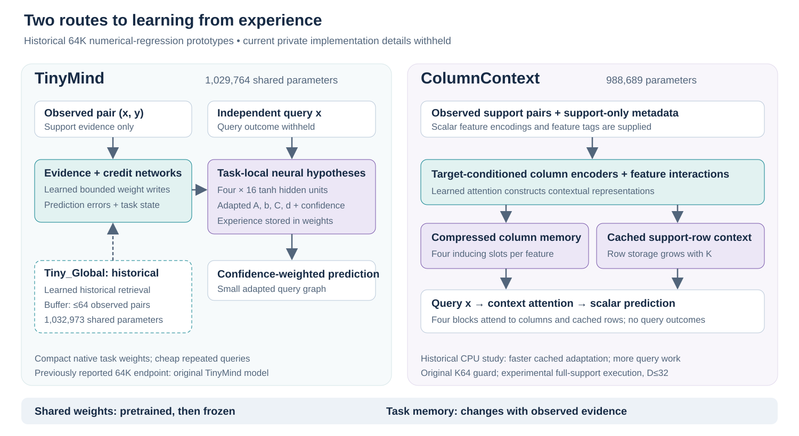

# Architecture

This page preserves previously published tabular architecture descriptions through 64K. That direction is now parked.

The active forecasting direction combines a shared recurrent forecasting core, learned features, persistent stream-local residual memory and confidence-controlled correction. Shared weights stay frozen during online evaluation; already arrived observations update memory. See the [conceptual mechanism and audited pilot](forecasting-research-update.md#mechanism-at-a-conceptual-level).

TinyMind and TinyMind-CC are separate research prototypes. Their common interface is a bounded numerical regression task with observed input/outcome pairs and independent query inputs. Shared neural weights are pretrained across functions and frozen during task adaptation. Synthetic confirmation primarily evaluates D4/8/16/32 features and K4/8/16/32/64 supports, with D6/12/24 held out. Real interfaces accept intermediate dimensions up to 32. The 2 November fixed 64K endpoints use the original architectures; later large-support execution is described separately below.

## TinyMind: experience stored in neural weights

The original D32-compatible model has **1,029,764 shared parameters**. Its task state contains four small hypotheses, each with 16 tanh hidden units and four output channels. A hypothesis evaluates `h = tanh(Ax + b)` and `F = Ch + d`. Confidence weights combine hypotheses, and the scalar adapter averages output channels. The four channels receive the same scalar training outcome; they do not demonstrate four distinct output tasks.

Shared evidence and credit networks observe the input, outcome, prediction errors, activations, task coefficients and observation count. They produce bounded updates to task-local A, b, C, d and confidence. These writable coefficients represent experience. Query prediction evaluates the small adapted hypotheses and does not execute the full evidence/credit network.

The native hidden-weight write follows the current augmented input direction. A separately controlled dimension-normalization correction changes its scale with D. This supplied mathematical correction must not be credited as a learned discovery. Tiny_C preserves the corrected native mechanism without historical retrieval.

## Historical Tiny_Global variant: learned historical retrieval

**Tiny_Global has 1,032,973 shared parameters** and is experimental. It keeps up to 64 ordinary observed x/y pairs. At a new observation, it recomputes historical predictions under the current task state. Learned query/key attention retrieves past evidence for each hidden unit; learned signed credit combines individual-hypothesis errors with the scalar ensemble prediction/error and confidence. The additional hidden-weight write can combine historical input directions. Native corrected writes and output updates remain.

The buffer, softmax, error multiplication, eligibility, normalization and bounds are supplied design assumptions. Retrieval and signed credit are learned from ordinary independent-query MSE. No query target, privileged equation label, external coefficient solver or task-time gradient optimizer enters this native adaptation.

Tiny_Basis has 1,032,857 parameters and uses local error feedback. Tiny_Global adds system-level feedback. Both have separately trained current-reader controls. A current-reader control retains the same buffer capacity and neural operations but reads repetitions of the current pair. Its native task-weight memory still carries past experience. This isolates the added historical read rather than removing all memory.

Final Tiny_Global familiar gains persist versus its **own** same-capacity Tiny_Global_current control: **2.33% / 2.10%**, with larger-support gains **5.14% / 4.84%**. Gains against the strongest declared Tiny_Basis_current control are reported separately. These comparisons and frozen corruption diagnostics support useful historical evidence use; they do not fully isolate global feedback from every other configuration difference.

## TinyMind-CC: experience stored in context

ColumnContext has **988,689 shared parameters**. Target-conditioned scalar cell encoders form column representations. Four learned inducing slots per feature compress column information; feature interactions construct row representations. Four attention context blocks and a scalar head predict query outcomes.

Task state contains the compressed column slots and cached support-row contexts. The row cache grows with K. The original API admits at most 64 supports and 32 features; 64 is a support admission guard, while 32 is a learned feature-shape limit. Query computation attends both the compressed column memory and cached rows. Larger-support experimental execution retains that growing row cache.

Supplied features include x², sinusoidal encodings with learned frequencies, support-only metadata and random feature tags. Neither these transformations nor preprocessing should be interpreted as concepts autonomously invented from evidence. Neural weights remain fixed at evaluation.

CC_D changes the training task-law difficulty/composition bundle; CC_G changes clipping from 1 to 5; CC_DG combines them. These interventions retain the same architecture, parameter count, learning rates and query-MSE objective. They did not restore broad learning.

## Earlier 64K endpoints and larger-support execution

The fixed 64K TinyMind / CC endpoints contain **1,029,764 / 988,689 parameters**, respectively. TinyMind seed 1877 and CC seed 1811 each have 64,000 cumulative optimizer steps and 2,304,000 cumulative synthetic task presentations. Changing training priors, batch size or conditioning did not add parameters or replace the native adaptation equations. Both architectures remain experimental.

The original synthetic protocol remains K≤64. A separate capability audit tested CC beyond that support admission guard. The TabArena-Lite evaluator executed the same TinyMind/CC equations on all official training supports, leaving the original guarded APIs unchanged. For CC, cached linear projections and independent query tiling retain every support key in attention. This is an inference execution extension, with no support subsampling, architecture redesign or enlarged feature capacity.

Within native K16/K64 cases, CC execution agreed with the original implementation to less than 10⁻⁶ maximum absolute prediction difference in the audited CPU/MPS preflight. Finite K96 and query-batch isolation checks passed. These checks support executor equivalence in the tested cases; they do not validate generalization to every large support size. TabArena supports extend well beyond the synthetic K64 training range, and D>32 remains unsupported.

No shared neural optimization was performed in the TabArena evaluation. Native task-local updates/context construction still use observed training outcomes. Neither the fixed 64K checkpoint nor the larger-support executor is a deployment-certified default.

## Why maintain both?

TinyMind exposes an explicit learned rule for changing task-local neural weights and makes repeated queries cheap. ColumnContext tests whether compressed contextual representations support useful learning at lower cost than full-support attention. Their different memory and compute profiles motivate parallel research paths. Measured accuracy, preprocessing and training lineage must be considered together; no result establishes one route as universally preferable.

The Transformer reference has **994,945 parameters**, four width-128 axial blocks, four attention heads and full support activations cached per layer. It uses the same support metadata/tags but a different embedding and initializer. The comparison tests an architectural bundle under a matched data/step recipe, with unequal compute.

## Checkpoint status

| Name | Status in this evidence release |
| --- | --- |
| TinyMind default11 | Preserved validated research default; no change or public weights |
| TinyMind replay233 | Experimental historical reference with additional replay and unmatched training lineage |
| ColumnContext S4, seeds 1301/1337 | Preserved, unpromoted research references |
| Tiny/CC fresh and fixed 8K endpoints, seeds 1811/1877 | Controlled pretraining-study endpoints; unpromoted |
| Tiny_Basis, Tiny_Global, CC_D, CC_G, CC_DG | Experimental plateau-repair variants; all full development gates failed |
| Tiny_H2 and CC_R2 | Earlier unsuccessful learned-mechanism hypotheses; no matched mechanism advantage demonstrated |
| Original TinyMind 64K, seed 1877 / CC 64K, seed 1811 | Earlier fixed research endpoints; audited, experimental and unpromoted; no public weights |
| Separate validation-selected Tiny 62K / CC 64K | Earlier selection records retained; the 32K→64K study reports fixed 64K for both |
| Latest six-dataset 70K experiment | Both 70K endpoints completed; validation selected Tiny64K / CC70K; experimental |
| New ongoing or unaudited variants | Excluded from this release's claims |

“Validated finding” describes an audited observation. It does not mean an experimental checkpoint has passed promotion, deployment or independent replication.

Provenance: architecture sources, parameter audits and historical reports are identified and hashed in [provenance.json](../benchmarks/provenance.json).
