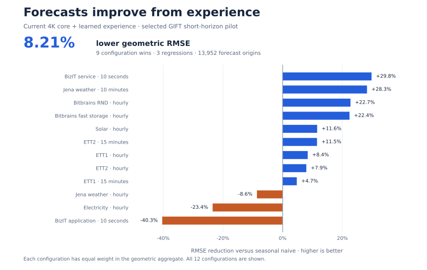
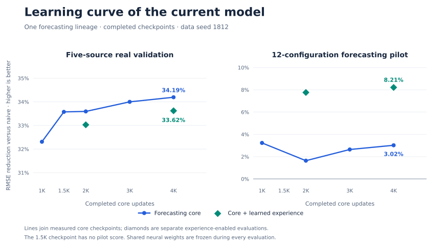

# TinyMind: forecasting from persistent experience

Evidence through **9 November 2026**.

**The current experience-enabled forecasting model achieves 8.21% lower geometric RMSE than seasonal naive and 5.35% lower RMSE than its own frozen core on the selected GIFT pilot.** The experience comparison improves eleven of twelve configurations, with zero shared-weight optimizer updates during evaluation.

## Forecast, observe, remember, improve

The forecasting core carries temporal state from observed history into the future sequence. Learned residual representations turn arriving outcomes into evidence for stream-local memory. Learned evidence weighting and confidence control determine how that memory corrects subsequent forecasts.

Shared neural weights freeze during evaluation. Only outcomes that have already arrived may update memory; unrelated streams start with separate state. This makes the scientific endpoint improvement in subsequent future predictions. The same-core comparison measures the complete experience path; it does not isolate the representation, memory and read policy individually.

## Current performance

The pilot retains **12 short-horizon GIFT configurations and 13,952 forecast origins per measured method**. A separate real validation pool has **five source configurations and 1,720 forecast windows**: blob access, electricity demand, weather, retail demand and traffic. The suites use different series and feedback sequences.

| Current 4K core and experience mode | Pilot RMSE reduction vs seasonal naive | Validation RMSE reduction vs naive |
|---|---:|---:|
| Frozen core | 3.02% | **34.19%** |
| Core + learned experience | **8.21%** | 33.62% |

The experience mode lowers pilot RMSE by **5.3532%** versus the same frozen core, with **11 wins / 1 loss**. Versus seasonal naive it has **9 wins / 3 losses**. On real validation, the correction worsens aggregate RMSE by **0.8711%**, improving two sources and regressing on three; the frozen core remains validation-selected.

Each configuration contributes equally through its RMSE ratio. Geometric RMSE reduction is `100 × (1 − exp(mean(log(candidate RMSE / reference RMSE))))`. Different target units are never combined by averaging raw RMSE. All results are descriptive point estimates.

## Current model learning curve

| Completed state | Pilot RMSE reduction vs seasonal naive | Validation RMSE reduction vs naive |
|---|---:|---:|
| Core 1K, data seed 1812 | 3.2317% | 32.3101% |
| Core 1.5K, data seed 1812 | — | 33.5748% |
| Core 2K, data seed 1812 | 1.6389% | 33.5942% |
| Core 2K + experience | 7.7612% | 33.0282% |
| Core 3K, data seed 1812 | 2.6429% | 33.9996% |
| Core 4K, data seed 1812 | 3.0218% | 34.1949% |
| Core 4K + experience | 8.2132% | 33.6217% |

From 1K to 2K, core validation RMSE falls **1.8970%**; from 2K to 4K it falls a further **0.9046%**. The frozen-core pilot trajectory is nonmonotonic. The experience-enabled points represent separate updater evaluations, not additional core steps or an interpolated training curve.

## Controls and data-seed replication

Mixed real/synthetic training at 1K reduces validation RMSE by **14.66% / 15.36%** relative to the corresponding synthetic-only controls. Both seeds improve all five validation configurations. The two data seeds share one initialization; they measure data-stream variation rather than initialization robustness.

The 1K pilot outcomes differ: seed 1811 has **0.0369% higher** RMSE than seasonal naive, while seed 1812 has **3.2317% lower** RMSE. All configurations and controls remain in the aggregate tables.

| Aggregate identifier | Study state |
|---|---|
| `mixed-1811-1000` / `mixed-1812-1000` | Current model at 1K, two data seeds |
| `mixed-1812-1500`, `-2000`, `-3000`, `-4000` | Completed core checkpoints in the current lineage |
| `mixed-1812-2000-adapted` / `mixed-1812-4000-adapted` | Frozen core with learned experience adaptation |
| `synthetic-period-1811` / `synthetic-period-1812` | Corresponding synthetic-only controls |
| `synthetic-original-1812` | Preserved earlier synthetic reference |

## Synthetic retention and interpretation

At 1K, mixed-data training increases geometric RMSE relative to the synthetic-only controls by **58.39% / 38.68%** on pure periodic probes, **18.04% / 18.83%** on generator probes and **8.42% / 7.07%** on family guards, for data seeds 1811 / 1812 respectively. Validation gains coexist with these synthetic regressions.

Continuing the seed-1812 core to 2K recovers **0.90% / 2.24% / 2.05%** RMSE on pure / generator / family panels versus 1K. This does not erase the earlier control-relative regressions. The matrix has 532 conditions and 664 metric rows after family expansion. Its single-origin forecasts start with empty memory, so the 2K experience mode equals the frozen core there. No new synthetic matrix was run for 3K, 4K or the 4K experience mode.

Pure periodic naive uses the true period and can have almost zero error. Matched-model comparisons are more informative than its poorly scaled percentage gaps. Family guards use last-observation naive when no period is declared.

The adapted 4K model has **33.22% higher** RMSE than published Moirai-2 and **52.44% higher** than published TimesFM-3 on the twelve keys. Published references were not rerun; matching keys do not establish matched pretraining, hardware or exact forecast-origin equivalence. The selected pilot, one initialization and absence of confidence intervals limit claims beyond this study.

## Inspect and reproduce the aggregate evidence

[Pilot configurations](../benchmarks/current-forecasting-pilot.csv) · [Validation configurations](../benchmarks/current-forecasting-real-validation.csv) · [Comparisons](../benchmarks/current-forecasting-comparisons.csv) · [Synthetic panels](../benchmarks/current-synthetic-summary.csv) · [Evidence hashes](../benchmarks/current-research-provenance.json)

[Verification and figure generation](../reproducibility/README.md) check table integrity, arithmetic, coverage and the plotted values. They do not rerun neural inference or produce independent external replication.
