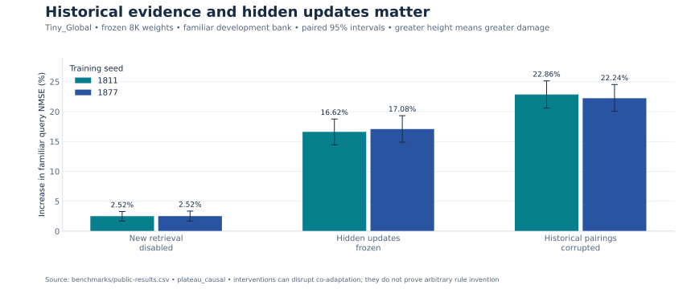
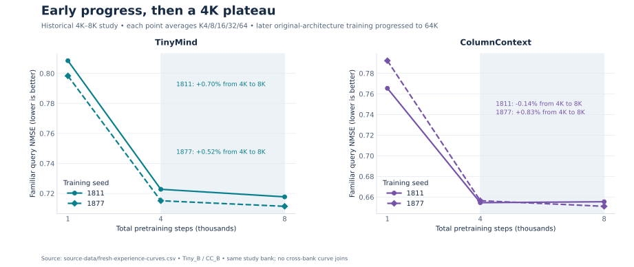
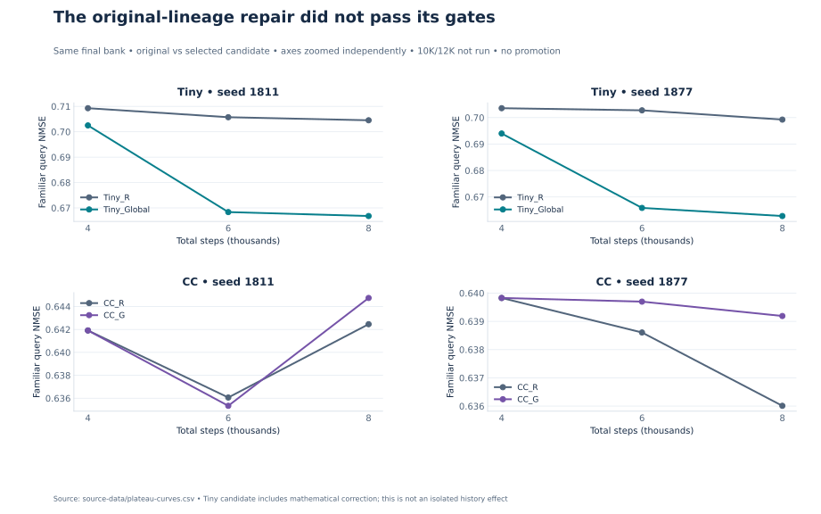
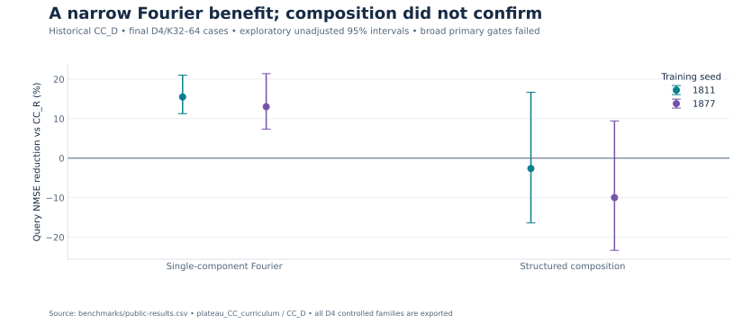
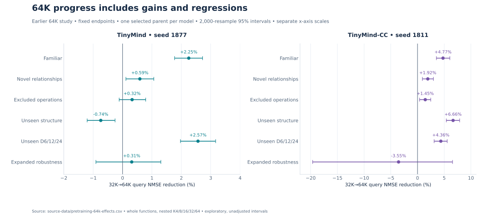

# Research progress

Evidence cutoff: **2 November 2026**. These milestones preserve both positive observations and rejected hypotheses. A failed gate does not erase a small gain; a small gain does not establish the wider goal.

## Phase 1 — Architecture research: prototypes completed

Working TinyMind weight-adaptation and ColumnContext attention prototypes are established in bounded numerical-regression experiments. TinyMind has cheap repeated predictions and compact task weights. ColumnContext compresses context and trades more query work/cache for faster adaptation. Historical TinyMind default11 remains unchanged; CC S4 is an unpromoted reference. The earlier fixed 64K endpoints retain the original 1,029,764 / 988,689-parameter architectures and are also experimental.

The 31 October matched Transformer study finds stronger all-K nonlinear accuracy for a conventional architecture, alongside substantial ColumnContext efficiency savings. This preserves an important control against attributing performance automatically to custom mechanisms.

## Phase 2 — Learning mechanisms: partial evidence, unresolved blockers

Observed pairs matter to the systems' predictions. The historical 1 November Tiny_Global history/feedback variant has reproducible familiar-query gains beyond separately trained current readers. Its own capacity-matched control yields 2.33% / 2.10% reductions; the strongest declared controls yield 2.34% / 2.06%. Added historical retrieval, hidden updates and correct historical pairings matter in frozen development diagnostics.

This is progress in evidence-dependent familiar learning. Reliable excluded-program benefits over the strongest matched controls, retention guarantees and cross-task concept reuse remain open.

## Historical original pretraining and the 4K–8K plateau

The controlled scaling study trained eight scratch arms to 8K. Familiar 1K→4K improvements range **5.5–17.8%** under changing source-to-mixed curricula. Familiar 4K→8K improvements are only **0.43–0.81%** on its own bank. These ranges describe that study's eight arms; they cannot be transferred to another bank or treated as a pure compute effect.

The subsequent fresh-experience study compares identical initialization/schedule with fixed-pool versus fresh function-and-observation coverage. Original fresh arms improve familiar error **10.60% / 10.42%** (Tiny) and **14.50% / 17.14%** (CC) from 1K to 4K. Their 4K→8K gains shrink to **0.70% / 0.52%** and **−0.14% / 0.83%**. Fresh-vs-fixed Tiny endpoint gains are 0.47% / 0.42%, while CC's effects are −0.33% / +0.83%. Fresh experience did not overcome the plateau under that schedule.

## Historical 1 November 4K→8K repair: useful sub-results, broad gate failure

Twenty continuations from the two original 4K parents test native replication, dimension correction, Tiny history/feedback and CC data×clipping interventions. Original 8K parameters and historical predictions reproduce exactly in the saved-artifact audit.

Tiny_Global improves familiar final error by 2.34% / 2.06% versus the strongest declared matched controls and 5.27% / 5.00% at K16/32/64. Against original Tiny_R, gains are larger, **5.35% / 5.21%**, because that contrast bundles the correction and additional changes. Those larger numbers must not be presented as the isolated history effect.

Progress from 6K to 8K remains small. CC's nominal selected clipping candidate regresses familiar all-K error by **0.36% / 0.50%**. No candidate passes that study's complete locked development gates; its gated 10K/12K endpoints are **not run**, rather than zero or missing successes. This did not prohibit later, separately designed original-architecture continuations. The original default remains unchanged.

CC_D confirms a narrow **single-component Fourier** benefit at D4/K32–64: **15.50% / 13.03%**, with positive unadjusted intervals. Earlier development composition gains do not reliably replicate: final composition effects are **−2.61% / −9.98%**, with wide intervals crossing zero.

## Later 8K→32K pretraining: additional progress

The broader-pretraining experiment extended original TinyMind and CC trajectories in seeds 1811/1877 to 32K, comparing original-prior continuation with a 50% original / 50% broader structured-law mixture. Its familiar 8K→32K reductions were **1.68–2.16% / 2.94–3.49%** for original-prior Tiny/CC arms and **1.50–1.88% / 3.12–3.69%** for broader-prior arms, on that study's bank. The broader prior improved some excluded/structure contrasts but did not show a familiar advantage over the original-prior control. This is a changed training-law bundle, not proof that more diversity alone caused improvement.

The later confirmation bank re-evaluates saved 8K through 64K checkpoints on the same functions; [its learning curves](../figures/pretraining-64k-curves.svg) do not splice scores from different banks.

## Earlier 32K→64K continuation: completed, with mixed transfer

One synthetic-validation-selected 32K parent per architecture continued: TinyMind seed **1877**, CC seed **1811**. Both completed **64,000 cumulative optimizer steps** and **2,304,000 cumulative synthetic task presentations per model**. The original parameter counts and architecture equations were retained; no experimental Tiny_Global promotion occurred.

Familiar confirmation NMSE fell **2.25%** for TinyMind and **4.77%** for CC. CC's unseen-structure NMSE fell **6.66%**, while TinyMind's rose **0.74%**. Both improved unseen-dimensional performance. Expanded-robustness intervals crossed zero, including a nominal CC regression. The six-track results use fixed 64K endpoints and 2,000 whole-function bootstrap resamples; one selected parent per architecture does not establish training-seed replication.

The continuation changed prior proportions, physical batch size and conditioning. A finite but explosive TinyMind K2 loss triggered a recorded prospective removal of K2; CC had excluded K2 from the outset. The run preserved weights/moments and completed the audited exposure totals. These conditions limit isolated causal attribution. [Protocol and audit](methodology.md#earlier-32k64k-continuation).

**The historical 4K–8K plateau was not a permanent training ceiling.** Later experiments demonstrated additional progress, without resolving all transfer or retention failures.

## Earlier real-world evaluation: TabArena-Lite at 64K

Both frozen models evaluated **11/13 regression datasets** using full original features and training supports. D1024 QSAR-TID-11 and D81 superconductivity exceeded the unchanged 32-feature capacity and were recorded as unsupported. TinyMind beat CC on **8/11** datasets; CC beat TinyMind on **3/11**. Neither beat the published TabPFN 3.5, CatBoost or XGBoost configuration on any of the 11 common datasets.

Geometric-mean RMSE gaps versus TabPFN 3.5 were **+69.63% TinyMind / +84.66% CC**. Positive is worse. These are conditional fixed-checkpoint comparisons on one official Lite outer split, not an official TabArena rank. The smaller real-data confirmation suite also remained mixed. Synthetic progress has not produced consistent real-world accuracy or established commercial superiority. [Complete earlier 64K benchmarks](../benchmarks/results.md#earlier-tabarena-lite-regression-at-64k).

## Latest completed 64K→70K failure-driven experiment

Both trajectories reached the shortened 70K endpoint, adding 6,000 steps and ending with 2,688,000 cumulative synthetic task presentations per model. Evaluations occurred every 2K steps. Complete-cohort validation selected TinyMind 64K and CC 70K before scoring the separate test partitions.

**CC70K reduced geometric-mean test RMSE 9.61% versus CC64K on six failure-driven evaluation datasets, not TabArena-Lite.** It improved on five datasets and regressed on gartner.corn. Tiny70K was 0.060% worse overall than Tiny64K despite five small gains; Davis regressed. Against the selected Tiny64K, CC70K was 16.60% better overall, with five wins.

Against traditional ML on identical up-to-64 support rows, CC had 13.44% lower geometric-mean RMSE than CatBoost (5/6 wins) but 4.61% higher than XGBoost (3/6 wins). With full-training tree baselines it was 5.01% behind CatBoost (3/6 wins) and 18.77% behind XGBoost (2/6 wins). Both data regimes are retained. TabPFN 3.5 was unavailable in this experiment, so no comparison to it is supported.

These are six-dataset, one-seed point estimates, conditional on datasets that informed development. No causal control isolates failure-driven adaptation, and test inputs cover only 4–12 features. Broader real-world accuracy, official TabArena standing and commercial superiority remain unestablished. Current architecture/training details, internal experiments and assets remain private. [Complete current evidence](../benchmarks/results.md#latest-70k-failure-driven-regression-six-datasets).

## Historical unsuccessful hypotheses and what they leave open

| Hypothesis or intervention | Observed outcome | Interpretation |
| --- | --- | --- |
| More fresh functions/observations alone | Small Tiny familiar gains; seed-dependent CC effects; plateau remains | Fixed-pool reuse is not a sufficient dominant explanation under the tested schedule |
| Higher post-4K learning rate | Small Tiny gains, CC regressions; full gates fail | Local trainability does not guarantee sustained held-out improvement |
| Variance-weighted query objective | Some excluded/structure gains survive incorrect pairings and can grow | Calibration changes cannot be attributed specifically to improved acquisition |
| Hidden-gate reset | Trainability improves while familiar query accuracy regresses | Opening a gate is insufficient |
| Restricted offline direction distillation | Suppressed writes and no reliable acquisition improvement | A supplied narrow direction basis did not solve credit assignment |
| Tiny_H2 recurrent history / CC_R2 extra retrieval | Matched reset/context controls reproduce the main improvements | Added memory availability is not a demonstrated mechanism benefit in that pilot |
| Full support-state optimizer fitting | Support error can approach zero while independent-query error worsens | Interpolation is not the scientific success endpoint |
| CC data×clipping factorial | Broad gates fail; Fourier subgroup succeeds, composition confirmation fails | These bounded training repairs do not restore broad original-prior learning |

Active gradients and parameter changes after 4K contradict a global vanishing-gradient explanation. Limited write directions, loss conditioning, sample-size interference, context compression and optimization remain interacting hypotheses. No unique cause or universal capacity ceiling is established.

## Phase 3 — Generalization: open

Excluded whole generating programs include order statistics, periodic remainder, signed fractional laws and localized chirps; their primitives can overlap training. A held-out program score is useful evidence but does not establish arbitrary unfamiliar relationship discovery. The target is consistent independent-query improvement, specific causal acquisition tests and transfer beyond supplied primitives.

## Phase 4 — Sustained pretraining: completed through 70K, mixed results

The earlier 64K→100K direction became an authorized experiment ending at 70K, using separate development data and evaluations every 2K steps. CC improved on the six-dataset test aggregate; TinyMind did not. Learning through 100K has not been demonstrated. Further progress needs broader separately reserved confirmation and training-seed replication; it is not guaranteed by this result.

Known six-dataset and TabArena-Lite outcomes cannot become untouched confirmation after influencing development. This publication launches no training and changes no private research.

## Phase 5 — Independent validation: initial comparison completed, replication open

Expand genuinely untouched dataset and environment tests, separate evidence count from recency, assess reliability and latency under deployed workloads, and enable independent replication through a deliberate asset/licensing decision. Agent adaptation and personalization have no validated results in this release. This roadmap initiates no new training or release.

Source reports and hashes: [provenance.json](../benchmarks/provenance.json). Full benchmark conditions: [results.md](../benchmarks/results.md).
